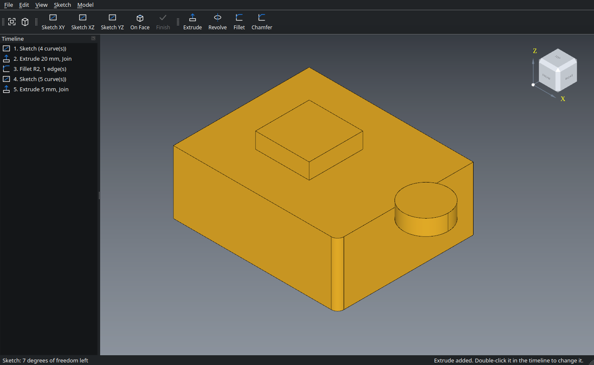

# OpenCaliper

A small, open-source **parametric 3D CAD** program for designing mechanical
parts and objects for 3D printing. Draw a 2D sketch, add constraints and
dimensions, turn it into a solid, then refine it with fillets and chamfers.
Every step stays editable in the timeline.



- 2D sketches: lines, rectangles, circles, arcs, polygons, slots, with
  constraints (coincident, horizontal, vertical, parallel, perpendicular,
  tangent, equal, symmetric, fix) and dimensions
- Trim, offset, mirror and corner fillets in sketches, construction (helper)
  geometry, constraint labels, undo inside sketches
- Parameters: name a size once (`width = 50`) and use formulas everywhere
  (`width / 2 + 5`); change it and the whole part follows
- Extrude, revolve, fillet, chamfer, shell, screw holes (M2 to M12, counterbored
  or countersunk), linear and circular patterns, mirror; join, cut, intersect
- Measure distances, angles, lengths and areas; volume, size and weight of the part
- Sketch on the origin planes or on any flat face of the part
- Dimensions on the model: hole diameters, sketch sizes and extrude depths;
  double-click one to change it and the part rebuilds
- Editable history timeline, undo and redo, autosave with crash recovery
- Export STEP, IGES, STL, OBJ, 3MF; import STEP, IGES, BREP
- Linux and Windows

## Download

| System | File |
|---|---|
| Linux (most distributions) | [**OpenCaliper-x86_64.AppImage**](https://github.com/open-workshop-tools/Open-Caliper/releases/latest/download/OpenCaliper-x86_64.AppImage) |
| Linux (any distribution with Flatpak) | [**OpenCaliper.flatpak**](https://github.com/open-workshop-tools/Open-Caliper/releases/latest/download/OpenCaliper.flatpak) |
| Windows 10 / 11 (64-bit) | [**OpenCaliper-windows-x64.exe**](https://github.com/open-workshop-tools/Open-Caliper/releases/latest/download/OpenCaliper-windows-x64.exe) (one file) or [OpenCaliper-windows-x64.zip](https://github.com/open-workshop-tools/Open-Caliper/releases/latest/download/OpenCaliper-windows-x64.zip) (folder) |

All versions: [Releases page](https://github.com/open-workshop-tools/Open-Caliper/releases).

### Which Linux file should I use?

**AppImage**: one file, nothing to install. It is built on Ubuntu 22.04 and
needs **glibc 2.35 or newer**.
**Flatpak**: works on practically every distribution, including older and
immutable ones, but downloads the KDE runtime (~400 MB) on first install.

| Distribution | AppImage | Flatpak |
|---|:---:|:---:|
| Ubuntu 22.04, 24.04 and newer (and Kubuntu, Xubuntu, ...) | ✅ ¹ | ✅ |
| Linux Mint 21 / 22, Pop!_OS 22.04+, Zorin OS 17+, elementary OS 7+ | ✅ ¹ | ✅ |
| Debian 12 and newer | ✅ | ✅ |
| Fedora 36 and newer (Workstation, KDE, ...) | ✅ | ✅ |
| Fedora Silverblue / Kinoite, Bazzite, other immutable distros | ✅ | ✅ (recommended) |
| Arch, Manjaro, EndeavourOS, CachyOS | ✅ | ✅ |
| openSUSE Tumbleweed | ✅ | ✅ |
| openSUSE Leap 15 | ❌ | ✅ |
| RHEL / AlmaLinux / Rocky 9 | ❌ (glibc 2.34) | ✅ |
| RHEL / AlmaLinux / Rocky 10 | ✅ | ✅ |
| Ubuntu 20.04, Debian 11 and older | ❌ (glibc too old) | ✅ |
| Steam Deck (desktop mode) | ⚠️ | ✅ |

¹ Ubuntu 24.04 and newer need the FUSE 2 library for AppImages:
`sudo apt install libfuse2t64`

**Requirements on every system:** 64-bit x86 PC (no ARM yet), a graphics
driver with OpenGL 3.3 or newer, and X11, or Wayland with XWayland. XWayland is
on by default in GNOME and KDE. OpenCaliper's 3D view runs through X11 for now.
macOS is not supported yet.

### Installing and running

**AppImage**
```sh
chmod +x OpenCaliper-x86_64.AppImage
./OpenCaliper-x86_64.AppImage
```
Or right-click the file → Properties → "Allow executing as program", then
double-click it.

**Flatpak**
```sh
flatpak install --user OpenCaliper.flatpak
flatpak run io.github.open_workshop_tools.OpenCaliper
```
Afterwards OpenCaliper is in your application menu. The Flatpak is not on
Flathub; to update, download the new file and install it again.

**Windows**: download `OpenCaliper-windows-x64.exe` and double-click it.
Nothing is installed: on the first start (a few seconds) it unpacks itself to
`%LOCALAPPDATA%\open-workshop-tools\OpenCaliper\app`, later starts are
immediate, and a newer version removes the old copy. If you prefer a plain
folder, unzip `OpenCaliper-windows-x64.zip` and run `OpenCaliper.exe` in the
`OpenCaliper` folder. If Windows SmartScreen warns about an unknown
publisher, choose "More info" → "Run anyway". The program is not code-signed.

## Quick start

1. **Sketch XY**: start drawing on the ground plane.
2. **L** for line: click corner after corner, click the first point again to
   close the shape. **C** for circle: click the center, then a point on the edge.
3. **Esc** twice switches to selection. Click a line and press **D** to give it
   an exact length.
4. **Finish** (Ctrl+Enter), then **Extrude** and enter a distance.
5. Click an edge of the part, then **Fillet** to round it.
6. Double-click a dimension on the part (for example the hole's **Ø**) or any
   step in the **Timeline** to change it later.
7. **Parameters** (Ctrl+P): add `width = 40`, then type `width` instead of a
   number in any size. Change it once and the part follows.

Mouse: left drag rotates, middle drag pans, the wheel zooms, **F** fits the
view, **0/1/2/3** select iso/front/top/right. The cube in the corner is
clickable.

## File formats

| | Extensions |
|---|---|
| OpenCaliper project | `.ocal` (JSON, keeps the editable history) |
| Export | `.step` `.stp`, `.iges` `.igs`, `.stl` (binary), `.obj`, `.3mf`, `.brep` |
| Import | `.step` `.stp`, `.iges` `.igs`, `.brep` |

Use 3MF (or STL) for 3D printing and STEP to exchange with other CAD programs.
STL, OBJ and 3MF are meshes, not solids, so they cannot be imported.

## Building from source

Needs a C++20 compiler, CMake 3.21+, Qt 6 (Widgets, OpenGLWidgets) and
Open CASCADE Technology 7.6+.

```sh
# Fedora
sudo dnf install gcc-c++ cmake ninja-build qt6-qtbase-devel opencascade-devel
# Debian / Ubuntu 24.04+
sudo apt install g++ cmake ninja-build qt6-base-dev libqt6opengl6-dev \
  libocct-foundation-dev libocct-modeling-algorithms-dev libocct-modeling-data-dev \
  libocct-visualization-dev libocct-data-exchange-dev

cmake -S . -B build -G Ninja -DCMAKE_BUILD_TYPE=Release
cmake --build build
ctest --test-dir build      # solver, model and project file tests
./build/opencaliper
```

Packages:
- AppImage: `packaging/appimage/build-appimage.sh` (needs podman or docker)
- Flatpak: `packaging/flatpak/build-flatpak.sh` (needs flatpak-builder)
- Windows: built by GitHub Actions (`.github/workflows/build.yml`, vcpkg + Qt)

**Making a release:** push a version tag, e.g.
`git tag v0.1.0 && git push origin v0.1.0`. GitHub Actions builds all three
files and publishes them on the Releases page, which updates the download
links above. If one platform fails, the others are published anyway; after
fixing it, move the tag to the new commit and the missing file is added to the
same release:
`git tag -f v0.1.0 && git push -f origin v0.1.0`.

## License

**OpenCaliper's own code is under the [MIT license](LICENSE).** You may use
it for any purpose, including commercial work, and copy, change and
redistribute it, as long as the copyright notice and license text stay with it.
The software comes without any warranty.

OpenCaliper is built on third-party libraries that keep **their own
licenses**. All of them are open source and allow this use:

| Library | Used for | License |
|---|---|---|
| [Open CASCADE Technology](https://github.com/Open-Cascade-SAS/OCCT) | geometry kernel, 3D view, STEP/IGES/STL | LGPL 2.1 + Open CASCADE exception |
| [Qt 6](https://www.qt.io) | user interface | LGPL 3.0 |
| [FreeType](https://freetype.org) | text rendering | FreeType License |
| HarfBuzz, ICU, zlib, libpng, PCRE2 and others | needed by Qt / OCCT | MIT, BSD, Zlib and similar |

What this means in practice:

- **Using OpenCaliper**, also commercially (designing parts you sell, for
  example), comes with no conditions. The parts you design are yours.
- **Changing or redistributing OpenCaliper's code**: keep the MIT license and
  copyright notice.
- **Redistributing the built program** (AppImage, Flatpak, zip) also
  redistributes Qt and Open CASCADE, which are LGPL. Then:
  - keep `LICENSE`, `THIRD-PARTY-NOTICES.md` and the `LICENSES/` folder with it
    (the packages already contain them);
  - keep the libraries as separate, replaceable shared libraries (they are);
  - point to the libraries' source code (see `THIRD-PARTY-NOTICES.md`).
- The Open CASCADE exception requires a notice that the program uses Open
  CASCADE Technology. It is in **Help → About** and in the notices file.
- **Names and logos:** "Open CASCADE" and "Qt" are trademarks of their owners.
  OpenCaliper is not affiliated with Autodesk, AutoCAD or Fusion 360. File
  formats are only used for compatibility (STEP is an ISO standard, IGES/STL/OBJ
  are open formats).

The full texts are in [`LICENSE`](LICENSE),
[`THIRD-PARTY-NOTICES.md`](THIRD-PARTY-NOTICES.md) and [`LICENSES/`](LICENSES/),
and inside the program under **Help → Licenses**.
